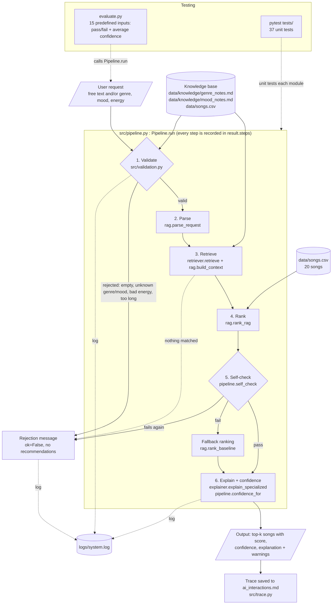

# 🎵 Music Recommender: Applied AI System

An offline, retrieval-augmented music recommender. A user describes what they want ("late night study session, something mellow", or a genre / mood / energy value). The system validates the request, **retrieves** relevant notes from a small knowledge base, uses them to **re-rank** the catalog and to **explain** every pick, runs a **self-check** on its own output, and reports a **confidence score** for each recommendation. No API keys or network access are needed.

## Base project

This extends **Music Recommender Simulation (Modules 1-3)**. The original project read 20 songs from `data/songs.csv`, scored each against a hand-declared taste profile (favorite genre +2.0, mood +1.0, energy closeness up to +1.0, plus optional extra-attribute terms), sorted by score and returned the top 5 with a reason string for every scoring term that fired. Its goal was to show that a scoring rule plus a sort is what a recommender is underneath, and to test how changing weights changes who gets recommended. Its stretch work added ranking modes (Strategy pattern), a diversity re-rank and table output. All of that is still here and unchanged (`python -m src.main` with no new flags); the original write-up is kept in [Base project details](#base-project-details-modules-1-3) below.

## What this version adds

| Capability | Where |
|---|---|
| **RAG**: three knowledge sources (`data/knowledge/genre_notes.md`, `mood_notes.md`, `data/songs.csv`) retrieved by `src/retriever.py`; retrieved notes change the ranking and are quoted in the explanation | `src/retriever.py`, `src/rag.py` |
| **Reliability**: input validation, guardrails, safe error handling, logging to `logs/system.log`, per-recommendation confidence | `src/validation.py`, `src/pipeline.py`, `src/logging_setup.py` |
| **Test harness**: `evaluate.py` (15 predefined inputs) and 37 pytest tests | `evaluate.py`, `tests/` |
| **Specialization**: constrained, few-shot style explanation template, compared with the baseline in the model card | `src/explainer.py` |
| **Agentic trace**: validate -> parse -> retrieve -> rank -> self-check -> explain, intermediate steps saved to [`ai_interactions.md`](ai_interactions.md) | `src/pipeline.py`, `src/trace.py` |

## Architecture overview

Source: [`diagrams/architecture.mmd`](diagrams/architecture.mmd) (Mermaid; GitHub renders it below). It mirrors `Pipeline.run` in `src/pipeline.py`.



1. **Validate** (`validation.py`): rejects empty, wrongly typed, unknown-genre/mood, out-of-range or over-long input with a message that says what to fix.
2. **Parse** (`rag.parse_request`): pulls genre / mood / energy out of free text using aliases from the notes ("rap" -> hip hop, "mellow" -> energy 0.35). Explicit fields win over text.
3. **Retrieve** (`retriever.py`): keyword-overlap scoring over genre notes, mood notes and song rows (names +4, aliases +3, topical keywords +1).
4. **Rank** (`rag.rank_rag`): the original score plus retrieval terms: inferred genre/mood/energy when the request omits them, +0.75 for a *related genre* in the notes, +0.5 for a related mood, +0.25 for energy inside the mood's typical range, +0.5 for a matching catalog `mood_tag`.
5. **Self-check** (`pipeline.self_check`): result count, no duplicates, sorted scores, top result relevant to the request. If the retrieval ranking fails, the pipeline falls back to the baseline rule and says so; if that also fails, nothing is returned.
6. **Explain + confidence**: the few-shot template (two sentences plus a confidence tag) quotes the matching knowledge note. Confidence = 0.55 * normalised score + 0.30 * preference coverage + 0.15 * retrieval support.

Testing happens at two levels (bottom of the diagram): `pytest` checks each module, `evaluate.py` runs the whole pipeline end to end.

## Setup, run and test

```bash
# 1. (optional) virtual environment
python3 -m venv .venv && source .venv/bin/activate

# 2. install dependencies (the retrieval pipeline and tests only need pytest;
#    tabulate is used just by the original table output)
pip install -r requirements.txt

# 3. run the system from the project root
python -m src.main --query "late night study session, something mellow"
python -m src.main --genre jazz --mood relaxed --energy 0.3 --compare     # before/after retrieval
python -m src.main --query "" --plain                                      # guardrail demo
python -m src.main --query "pumped up workout" --no-rag                    # retrieval off
python -m src.main --query "study music" --trace trace.md                  # save the step-by-step trace
python -m src.trace                                                        # regenerate traces in ai_interactions.md
python -m src.compare_explanations                                         # baseline vs specialized text

# 4. test
python evaluate.py        # 15 predefined inputs, pass/fail summary, average confidence, exit code 0 on success
pytest                    # 37 unit tests
```

Real command outputs are saved in [`assets/`](assets/) (`evaluate_output.txt`, `pytest_output.txt`, `example*.txt`, `guardrail_*.txt`, `explanation_comparison.txt`, `system_log_sample.txt`).

## Example inputs and real outputs

All outputs below were produced by running the commands shown (copies in `assets/`).

### Example 1: free text, no genre given

`python -m src.main --query "late night study session, something mellow" --compare -k 3`

The baseline can only use what the text parser extracts (mood chill, energy 0.35); retrieval also infers *lofi* from the notes and lifts the lofi songs.

```text
=== WITHOUT retrieval (baseline) ===
Request: {'text': 'late night study session, something mellow'}
Mode: baseline | overall confidence: 0.84

1. Library Rain by Paper Lanterns - Score: 2.00 - Confidence: 0.85
   Because: mood match (+1.0), energy similarity (+1.00)
2. Spacewalk Thoughts by Orbit Bloom - Score: 1.93 - Confidence: 0.83
   Because: mood match (+1.0), energy similarity (+0.93)
3. Midnight Coding by LoRoom - Score: 1.93 - Confidence: 0.83
   Because: mood match (+1.0), energy similarity (+0.93)

=== WITH retrieval ===
Request: {'text': 'late night study session, something mellow'}
Mode: rag | overall confidence: 0.98

1. Library Rain by Paper Lanterns - Score: 3.25 - Confidence: 1.00
   Because: Library Rain by Paper Lanterns ranks here because its mood (chill) matches, its energy (0.35) is close to your target and lofi fits what you described. Lofi is low-tempo, mostly instrumental and warm, which is why it dominates study and coding playlists. [high confidence 1.00]
2. Midnight Coding by LoRoom - Score: 3.18 - Confidence: 1.00
   Because: Midnight Coding by LoRoom ranks here because its mood (chill) matches, its energy (0.42) is close to your target and lofi fits what you described. Lofi is low-tempo, mostly instrumental and warm, which is why it dominates study and coding playlists. [high confidence 1.00]
3. Spacewalk Thoughts by Orbit Bloom - Score: 2.93 - Confidence: 0.94
   Because: Spacewalk Thoughts by Orbit Bloom ranks here because its mood (chill) matches, its energy (0.28) is close to your target and ambient is a neighbouring genre in the notes. Ambient favours texture over rhythm. [high confidence 0.94]
```

### Example 2: before/after retrieval for a structured request

`python -m src.main --genre jazz --mood relaxed --energy 0.3 --compare -k 3`

There is only one jazz song. The baseline fills ranks 2-3 with whatever is closest in energy (reggae, ambient). Retrieval uses the jazz and relaxed notes (lofi is a related genre, chill a related mood), so the quiet lofi songs take ranks 2-3, each with a cited reason. Overall confidence moves from 0.49 to 0.79.

```text
=== WITHOUT retrieval (baseline) ===
Request: {'genre': 'jazz', 'mood': 'relaxed', 'energy': 0.3}
Mode: baseline | overall confidence: 0.49
WARNING: Low confidence (0.49): the catalog has few songs matching this request.

1. Coffee Shop Stories by Slow Stereo - Score: 3.93 - Confidence: 0.84
   Because: genre match (+2.0), mood match (+1.0), energy similarity (+0.93)
2. Island Drift by Salt Tide - Score: 1.72 - Confidence: 0.39
   Because: mood match (+1.0), energy similarity (+0.72)
3. Spacewalk Thoughts by Orbit Bloom - Score: 0.98 - Confidence: 0.23
   Because: energy similarity (+0.98)

=== WITH retrieval ===
Request: {'genre': 'jazz', 'mood': 'relaxed', 'energy': 0.3}
Mode: rag | overall confidence: 0.79

1. Coffee Shop Stories by Slow Stereo - Score: 4.18 - Confidence: 1.00
   Because: Coffee Shop Stories by Slow Stereo ranks here because its genre (jazz) matches, its mood (relaxed) matches and its energy (0.37) is close to your target. Jazz is improvisational and mellow in its lounge forms. [high confidence 1.00]
2. Library Rain by Paper Lanterns - Score: 2.45 - Confidence: 0.69
   Because: Library Rain by Paper Lanterns ranks here because its energy (0.35) is close to your target, lofi is a neighbouring genre in the notes and chill is a related mood in the notes. Lofi is low-tempo, mostly instrumental and warm, which is why it dominates study and coding playlists. [medium confidence 0.69]
3. Midnight Coding by LoRoom - Score: 2.38 - Confidence: 0.68
   Because: Midnight Coding by LoRoom ranks here because its energy (0.42) is close to your target, lofi is a neighbouring genre in the notes and chill is a related mood in the notes. Lofi is low-tempo, mostly instrumental and warm, which is why it dominates study and coding playlists. [medium confidence 0.68]
```

### Example 3: contradictory request (sad blues at high energy)

`python -m src.main --genre blues --mood sad --energy 0.95 -k 3`

The mood note says sad music typically runs at 0.20-0.55 energy, so the system warns about the contradiction and the confidence drops.

```text
=== WITH retrieval ===
Request: {'genre': 'blues', 'mood': 'sad', 'energy': 0.95}
Mode: rag | overall confidence: 0.61
WARNING: Energy 0.95 is unusual for mood 'sad' (typical 0.20-0.55); expect a compromise between mood and energy.

1. Porch Light Blues by Delta Mae - Score: 3.75 - Confidence: 0.87
   Because: Porch Light Blues by Delta Mae ranks here because its genre (blues) matches, its mood (sad) matches and its energy (0.45) is far from your target. Blues is built on expressive guitar and sorrowful lyrics and rarely runs at high energy. [high confidence 0.87]
2. Storm Runner by Voltline - Score: 1.71 - Confidence: 0.54
   Because: Storm Runner by Voltline ranks here because its energy (0.91) is close to your target and rock is a neighbouring genre in the notes. Rock is guitar-driven and loud. [medium confidence 0.54]
3. Dust Road Home by Hollow Pines - Score: 1.60 - Confidence: 0.42
   Because: Weaker match: Dust Road Home by Hollow Pines ranks here because its energy (0.55) is only partly near your target, country is a neighbouring genre in the notes and its energy (0.55) sits in the typical range for the mood. Country is story-driven and nostalgic. [low confidence 0.42]
```

### Retrieval changes behavior: summary

| Request | Baseline top 3 (no retrieval) | With retrieval top 3 |
|---|---|---|
| `jazz / relaxed / 0.3` | Coffee Shop Stories, Island Drift, Spacewalk Thoughts | Coffee Shop Stories, Library Rain, Midnight Coding |
| "late night study session, something mellow" | Library Rain, Spacewalk Thoughts, Midnight Coding | Library Rain, Midnight Coding, Spacewalk Thoughts |

## Reliability and guardrails

Every rejection is logged at WARNING level in `logs/system.log` (git-ignored; a sample is in `assets/system_log_sample.txt`). Unexpected exceptions are caught in `Pipeline.run`, logged with a traceback, and returned as a generic failure rather than crashing.

| Input | Behavior | Result (real output) |
|---|---|---|
| `--query ""` (empty) | Rejected at validation | `REJECTED: Empty request: give a description (text) and/or a genre, mood or energy value.` |
| `--genre zydeco` (unknown genre) | Rejected; lists known genres, adds "Did you mean" when close | `REJECTED: Unknown genre 'zydeco'. Known genres: ambient, blues, classical, ...` |
| `--genre rock --energy 7` (out of range) | Rejected | `REJECTED: energy must be between 0.0 and 1.0, got 7.0` |
| `--energy abc` | Rejected (not a number) | `REJECTED: energy must be a number between 0 and 1, got 'abc'` |
| mood `chil` (typo) | Rejected with a suggestion | message names `chill` (checked in `evaluate.py`) |
| 300+ characters of text | Rejected | `text is too long (599 characters; the limit is 300)` |
| `{"genre": "pop", "artist": "x"}` | Unknown fields rejected, not ignored | `Unsupported field(s): artist. ...` |
| gibberish text `qwzx plorb` | Nothing retrieved, nothing parsed: rejected rather than guessing | `Could not match the request to any known genre, mood or topic. ...` |
| `--genre blues --mood sad --energy 0.95` | Accepted with a warning (retrieval notes show the contradiction) | `WARNING: Energy 0.95 is unusual for mood 'sad' ...`, overall confidence 0.61 |
| knowledge folder missing | Refused safely (tested in `test_missing_knowledge_base_degrades_safely`) | `knowledge base unavailable, cannot validate input`, logged at ERROR; no crash |

Real output for the first three:

```text
=== WITH retrieval ===
Request: {'text': ''}
REJECTED: Empty request: give a description (text) and/or a genre, mood or energy value.

=== WITH retrieval ===
Request: {'genre': 'zydeco'}
REJECTED: Unknown genre 'zydeco'. Known genres: ambient, blues, classical, country, edm, folk, hip hop, indie pop, jazz, lofi, metal, pop, r&b, reggae, rock, synthwave.

=== WITH retrieval ===
Request: {'genre': 'rock', 'energy': 7.0}
REJECTED: energy must be between 0.0 and 1.0, got 7.0
```

**Confidence score.** Each recommendation gets 0-1: 0.55 * (score / best achievable score for that request) + 0.30 * (share of genre/mood/energy dimensions it satisfies; "related per notes" counts half) + 0.15 * (1 if retrieved notes contributed). The overall confidence is the mean over the returned songs, and below 0.50 the system prints a low-confidence warning. It is a heuristic, not a calibrated probability.

## Evaluation harness

`python evaluate.py` (real output, also in `assets/evaluate_output.txt`):

```text
Running 15 evaluation cases

[PASS]  1. Structured: pop / happy / 0.8        -> ok, confidence 0.79
[PASS]  2. Free text: late-night study          -> ok, confidence 0.93
[PASS]  3. Free text: gym workout               -> ok, confidence 0.88
[PASS]  4. Related genre surfaces (jazz)        -> ok, confidence 0.71
[PASS]  5. Edge: empty string                   -> rejected: Empty request: give a description (text) and/or a genre, moo
[PASS]  6. Edge: whitespace only                -> rejected: Empty request: give a description (text) and/or a genre, moo
[PASS]  7. Edge: unknown genre                  -> rejected: Unknown genre 'zydeco'. Known genres: ambient, blues, classi
[PASS]  8. Edge: unknown mood with typo hint    -> rejected: Unknown mood 'chil'. Known moods: angry, chill, confident, e
[PASS]  9. Edge: energy out of range            -> rejected: energy must be between 0.0 and 1.0, got 1.7
[PASS] 10. Edge: energy is not a number         -> rejected: energy must be a number between 0 and 1, got 'loud'
[PASS] 11. Edge: wrong type (int)               -> rejected: Request must be text or a dict, got int
[PASS] 12. Edge: gibberish text                 -> rejected: Could not match the request to any known genre, mood or topi
[PASS] 13. Edge: very long text                 -> rejected: text is too long (599 characters; the limit is 300)
[PASS] 14. Contradiction: sad blues at 0.95     -> ok, confidence 0.52
[PASS] 15. Unknown key is rejected              -> rejected: Unsupported field(s): artist. Allowed: energy, genre, mood, 

Summary: 15/15 passed
Average confidence over 5 successful recommendation runs: 0.77
```

## Design decisions and trade-offs

- **Keyword retrieval instead of embeddings or an LLM.** The brief required offline, no-key operation, and with 50 entries keyword overlap is transparent: every hit lists the words that matched. The cost is that synonyms not in the notes ("cosy" vs "cozy") miss.
- **Retrieval changes scores, not just text.** Appending a note to an explanation would be cosmetic. Adjacency and inference terms are small (0.25-1.0) so an exact genre match (+2.0) still outranks them; that keeps the original behavior predictable but also keeps the genre bias.
- **Template explanations instead of free generation.** The specialized explanation can only state facts from the song row and the terms that fired, so it cannot invent a reason. The cost is repetitive wording.
- **Reject rather than guess.** Unknown genres, gibberish and out-of-range numbers are refused with a message. Friendlier fuzzy matching would hide mistakes.
- **Self-check with fallback.** A failed check drops back to the original rule rather than showing a suspicious ranking. In practice it has not triggered on the test inputs, so that path is covered by design rather than by a real failure.
- **Confidence is a transparent formula.** Easy to explain, but it is not calibrated (see the model card).
- **The original `src/main.py` behavior is untouched**; the new mode only activates with `--query/--genre/--mood/--energy`. `tabulate` is imported lazily so the new mode runs without it.

## Testing summary

- `pytest`: **37 of 37 passed** (5 original recommender tests, 32 new tests for retrieval, RAG ranking, validation, pipeline, explanation format and trace saving).
- `python evaluate.py`: **15 of 15 passed**, average confidence **0.77** over the 5 cases that produce recommendations; exit code 0.
- What the testing found: see "What surprised me while testing reliability" in the model card (an explanation that overstated an energy match, a whitespace-normalization bug, a hard `tabulate` dependency).

## Model card

See [`model_card.md`](model_card.md) for limitations and biases, misuse and prevention, reliability surprises, AI collaboration, future improvements, and the baseline-vs-specialized comparison.

## Repository layout

```text
data/songs.csv, data/knowledge/{genre_notes,mood_notes}.md   knowledge sources
src/retriever.py   src/rag.py   src/validation.py   src/pipeline.py   new system
src/explainer.py   src/trace.py   src/logging_setup.py   src/compare_explanations.py
src/recommender.py   src/main.py                              original recommender + CLI
evaluate.py   tests/                                          evaluation harness and unit tests
diagrams/architecture.mmd   assets/   logs/system.log          diagram, saved outputs, runtime log
ai_interactions.md   model_card.md                            agentic trace, model card
```

---

# Base project details (Modules 1-3)

The sections below are the original Music Recommender Simulation write-up.

## Project Summary (original)

A small content-based music recommender. It reads 20 songs from a CSV, scores each one against a user taste profile (genre, mood, energy, plus optional extra attributes), and returns the top 5 with a reason string for every term that fired. I built it to see how a scoring rule plus a sort is really what a recommender is underneath, and to test how changing the weights changes who gets recommended.

---

## How The System Works

### How real recommenders work

Production systems such as Spotify and YouTube combine two broad signals:

- **Content-based signals**: attributes of the item itself. Spotify exposes audio features such as `energy`, `danceability`, `valence` (musical positivity), `acousticness`, and `tempo` (BPM), plus metadata like genre tags, artist, and release year. YouTube adds video-level features such as title/description text, category, and language.
- **Collaborative signals**: user behavior. Plays, skips, saves, playlist adds, replays, watch time, and likes are logged per user. Users with similar histories are treated as neighbors (matrix factorization / embeddings), so a song can be recommended because similar listeners liked it, even if its audio features look nothing like your favorites.

A large-scale system runs in stages: (1) *candidate generation* narrows millions of items to a few hundred using embeddings, (2) a *ranking model* scores each candidate for the specific user (predicted probability of play, completion, or save), and (3) *re-ranking* applies business rules such as diversity, freshness, and de-duplication. Implicit feedback (a skip within 30 seconds is a strong negative) usually outweighs explicit ratings because there is far more of it.

This project is a small **content-based** simulation. It has no user history and no collaborative filtering; it replaces the learned ranking model with a hand-written scoring rule so every recommendation is explainable.

### (a) Input data: song attributes

Each row of `data/songs.csv` is one song with:

| Attribute | Type | Role in this system |
|---|---|---|
| `genre` | categorical (pop, lofi, rock, ...) | Scored: exact match |
| `mood` | categorical (happy, chill, intense, ...) | Scored: exact match |
| `energy` | float 0-1 | Scored: closeness to the user's target |
| `tempo_bpm` | number | Loaded, not scored in the baseline |
| `valence`, `danceability`, `acousticness` | float 0-1 | Loaded, not scored in the baseline |
| `id`, `title`, `artist` | identifiers | Display only |

### (b) User preferences: the taste profile

A profile is a small dictionary, for example `{"genre": "pop", "mood": "happy", "energy": 0.8}`: one favorite genre, one favorite mood, and a target energy level. There is no listening history; the profile is declared directly and is a single static point in feature space.

### (c) Ranking and selection: score, then sort

1. **Scoring rule** (one song at a time): `score_song(user_prefs, song)` adds up
   - genre match: **+2.0** if `song.genre == user.genre`
   - mood match: **+1.0** if `song.mood == user.mood`
   - energy similarity: **+(1 - |song.energy - target_energy|)**, which lies in 0 to 1 (1.0 is a perfect match)

   The maximum possible score is 4.0. The function returns `(score, reasons)`, where `reasons` lists only the terms that fired.
2. **Ranking rule** (whole catalog): `recommend_songs` scores every song, sorts by score descending (ties keep CSV order), and returns the top `k` (default 5) with a reason string.

I weighted genre twice as heavily as mood, and a genre match (+2.0) is worth more than a perfect energy score (at most +1.0). So a same-genre song can outrank an off-genre song that is a better match on mood and energy combined, which the experiments below probe.

### Expected biases

Before running anything I expected three biases, and the runs confirmed them (details in `model_card.md`):

- **Genre over-prioritized**: with genre worth +2.0, a same-genre song beats better mood/energy matches from other genres. In the adversarial run the only blues song scored 3.50 despite a 0.50 energy gap.
- **Small-catalog filler**: most genres have a single song, so after the on-genre result the list is just "closest in energy" (Deep Intense Rock has one rock song).
- **Exact-match labels**: `pop` and `indie pop` (or `chill` and `relaxed`) count as completely different.

---

## Getting Started

### Setup

1. Create a virtual environment (optional but recommended):

   ```bash
   python -m venv .venv
   source .venv/bin/activate      # Mac or Linux
   .venv\Scripts\activate         # Windows
   ```

2. Install dependencies

   ```bash
   pip install -r requirements.txt
   ```

3. Run the app:

   ```bash
   python -m src.main                                   # all profiles, balanced mode, table output
   python -m src.main --mode mood-first                 # genre-first | mood-first | energy-similarity | balanced | all
   python -m src.main --diversity                       # artist/genre repetition penalty
   python -m src.main --profile "Chill Lofi" -k 5       # one profile (name or unique substring)
   python -m src.main --basic --plain                   # baseline 3-term scoring, plain text
   ```

### Running Tests

```bash
pytest
```

You can add more tests in `tests/test_recommender.py`.

---

## Sample Recommendation Output

Every recommendation prints the exact scoring terms that fired. Three examples taken from the High-Energy Pop run below (ranks 1, 2 and 4):

```text
1. Sunrise City by Neon Echo - Score: 3.92
   Because: genre match (+2.0), mood match (+1.0), energy similarity (+0.92)
2. Gym Hero by Max Pulse - Score: 2.97
   Because: genre match (+2.0), energy similarity (+0.97)
4. Rooftop Lights by Indigo Parade - Score: 1.86
   Because: mood match (+1.0), energy similarity (+0.86)
```

### Baseline profile runs (genre +2.0, mood +1.0, energy similarity)

Produced with `python -m src.main --basic --plain` (`--basic` ignores the stretch attributes so only the three baseline terms are used). Each profile returns its top 5 of 20 songs.

**High-Energy Pop**

```text
=== High-Energy Pop | mode=balanced | diversity=off ===
Profile: genre=pop, mood=happy, energy=0.9

1. Sunrise City by Neon Echo - Score: 3.92
   Because: genre match (+2.0), mood match (+1.0), energy similarity (+0.92)
2. Gym Hero by Max Pulse - Score: 2.97
   Because: genre match (+2.0), energy similarity (+0.97)
3. Neon Ballroom by Velour - Score: 2.78
   Because: genre match (+2.0), energy similarity (+0.78)
4. Rooftop Lights by Indigo Parade - Score: 1.86
   Because: mood match (+1.0), energy similarity (+0.86)
5. Storm Runner by Voltline - Score: 0.99
   Because: energy similarity (+0.99)
```

**Chill Lofi**

```text
=== Chill Lofi | mode=balanced | diversity=off ===
Profile: genre=lofi, mood=chill, energy=0.35

1. Library Rain by Paper Lanterns - Score: 4.00
   Because: genre match (+2.0), mood match (+1.0), energy similarity (+1.00)
2. Midnight Coding by LoRoom - Score: 3.93
   Because: genre match (+2.0), mood match (+1.0), energy similarity (+0.93)
3. Focus Flow by LoRoom - Score: 2.95
   Because: genre match (+2.0), energy similarity (+0.95)
4. Spacewalk Thoughts by Orbit Bloom - Score: 1.93
   Because: mood match (+1.0), energy similarity (+0.93)
5. Coffee Shop Stories by Slow Stereo - Score: 0.98
   Because: energy similarity (+0.98)
```

**Deep Intense Rock**

```text
=== Deep Intense Rock | mode=balanced | diversity=off ===
Profile: genre=rock, mood=intense, energy=0.92

1. Storm Runner by Voltline - Score: 3.99
   Because: genre match (+2.0), mood match (+1.0), energy similarity (+0.99)
2. Gym Hero by Max Pulse - Score: 1.99
   Because: mood match (+1.0), energy similarity (+0.99)
3. Pulse Garden by Kairo Wave - Score: 0.98
   Because: energy similarity (+0.98)
4. Iron Cathedral by Ashen Gate - Score: 0.95
   Because: energy similarity (+0.95)
5. Sunrise City by Neon Echo - Score: 0.90
   Because: energy similarity (+0.90)
```

**Adversarial (sad blues at max energy)**

```text
=== Adversarial (sad blues at max energy) | mode=balanced | diversity=off ===
Profile: genre=blues, mood=sad, energy=0.95

1. Porch Light Blues by Delta Mae - Score: 3.50
   Because: genre match (+2.0), mood match (+1.0), energy similarity (+0.50)
2. Pulse Garden by Kairo Wave - Score: 0.99
   Because: energy similarity (+0.99)
3. Gym Hero by Max Pulse - Score: 0.98
   Because: energy similarity (+0.98)
4. Iron Cathedral by Ashen Gate - Score: 0.98
   Because: energy similarity (+0.98)
5. Storm Runner by Voltline - Score: 0.96
   Because: energy similarity (+0.96)
```

**How the profiles differ.** High-Energy Pop and Chill Lofi both get a full 3-term match at rank 1 (3.92 and 4.00), but Pop has only three pop songs, so its list drops to mood-only and energy-only matches by rank 4-5, while Lofi has three lofi songs and fills ranks 1-3 with genre matches. Deep Intense Rock has just one rock song; after it, rank 2 is a pop song (Gym Hero) that matches only on mood, and ranks 3-5 are pure energy matches from metal, EDM and pop, with scores bunched between 0.90 and 0.98. The adversarial blues/sad/0.95 profile shows the weight problem clearly: the only blues song scores 3.50 despite an energy gap of 0.50, and every other result is below 1.0, so the user gets one on-genre song and four loud songs that are nothing like a sad blues listener's taste.

---

## Stretch Features

### A. Extra attributes

`data/songs.csv` has five more columns: `popularity` (0-100), `release_decade`, `mood_tag` (a detailed mood such as *cozy* or *gritty*), `instrumentalness` and `liveness`. A profile can opt in to any of them, and each one adds at most **+0.5**, so the three core terms still dominate:

| Profile key | Song column | Term |
|---|---|---|
| `mood_tag` | `mood_tag` | +0.5 on exact match |
| `target_decade` | `release_decade` | +0.5 on exact match |
| `target_popularity` | `popularity` | 0.5 * (1 - abs(diff) / 100) |
| `target_acousticness`, `target_danceability`, `target_instrumentalness`, `target_liveness` | same-named column | 0.5 * (1 - abs(diff)) |

Terms only fire when the profile has the key, so the baseline outputs above stay reproducible with `--basic`.

### B. Diversity penalty (`--diversity`)

After scoring, the top k is built greedily: each pick subtracts **1.0** per earlier pick by the same artist and **0.5** per earlier pick in the same genre. The penalties appear in the reason string. Chill Lofi with the extra attributes, with the penalty off and on (note that Focus Flow, a second LoRoom song, slides from rank 3 to rank 4 and loses 2.0 points: -1.0 artist repeat, -1.0 for two earlier lofi picks):

```text
=== Chill Lofi | mode=balanced | diversity=off ===
Profile: genre=lofi, mood=chill, energy=0.35, mood_tag=cozy, target_decade=2020, target_popularity=55, target_acousticness=0.8, target_instrumentalness=0.6

|   Rank | Title               | Artist         |   Score | Reasons                                                                                                                                                                                                                     |
|--------|---------------------|----------------|---------|-----------------------------------------------------------------------------------------------------------------------------------------------------------------------------------------------------------------------------|
|      1 | Midnight Coding     | LoRoom         |    6.31 | genre match (+2.0), mood match (+1.0), energy similarity (+0.93), mood tag 'cozy' match (+0.50), 2020s release (+0.50), popularity similarity (+0.46), acousticness similarity (+0.45), instrumentalness similarity (+0.48) |
|      2 | Library Rain        | Paper Lanterns |    5.92 | genre match (+2.0), mood match (+1.0), energy similarity (+1.00), 2020s release (+0.50), popularity similarity (+0.50), acousticness similarity (+0.47), instrumentalness similarity (+0.45)                                |
|      3 | Focus Flow          | LoRoom         |    4.82 | genre match (+2.0), energy similarity (+0.95), 2020s release (+0.50), popularity similarity (+0.47), acousticness similarity (+0.49), instrumentalness similarity (+0.40)                                                   |
|      4 | Spacewalk Thoughts  | Orbit Bloom    |    3.15 | mood match (+1.0), energy similarity (+0.93), popularity similarity (+0.42), acousticness similarity (+0.44), instrumentalness similarity (+0.35)                                                                           |
|      5 | Coffee Shop Stories | Slow Stereo    |    2.69 | energy similarity (+0.98), mood tag 'cozy' match (+0.50), popularity similarity (+0.47), acousticness similarity (+0.46), instrumentalness similarity (+0.28)                                                               |
```

```text
=== Chill Lofi | mode=balanced | diversity=on ===
Profile: genre=lofi, mood=chill, energy=0.35, mood_tag=cozy, target_decade=2020, target_popularity=55, target_acousticness=0.8, target_instrumentalness=0.6

|   Rank | Title               | Artist         |   Score | Reasons                                                                                                                                                                                                                     |
|--------|---------------------|----------------|---------|-----------------------------------------------------------------------------------------------------------------------------------------------------------------------------------------------------------------------------|
|      1 | Midnight Coding     | LoRoom         |    6.31 | genre match (+2.0), mood match (+1.0), energy similarity (+0.93), mood tag 'cozy' match (+0.50), 2020s release (+0.50), popularity similarity (+0.46), acousticness similarity (+0.45), instrumentalness similarity (+0.48) |
|      2 | Library Rain        | Paper Lanterns |    5.42 | genre match (+2.0), mood match (+1.0), energy similarity (+1.00), 2020s release (+0.50), popularity similarity (+0.50), acousticness similarity (+0.47), instrumentalness similarity (+0.45), genre repeat (-0.5)           |
|      3 | Spacewalk Thoughts  | Orbit Bloom    |    3.15 | mood match (+1.0), energy similarity (+0.93), popularity similarity (+0.42), acousticness similarity (+0.44), instrumentalness similarity (+0.35)                                                                           |
|      4 | Focus Flow          | LoRoom         |    2.82 | genre match (+2.0), energy similarity (+0.95), 2020s release (+0.50), popularity similarity (+0.47), acousticness similarity (+0.49), instrumentalness similarity (+0.40), artist repeat (-1.0), genre repeat (-1.0)        |
|      5 | Coffee Shop Stories | Slow Stereo    |    2.69 | energy similarity (+0.98), mood tag 'cozy' match (+0.50), popularity similarity (+0.47), acousticness similarity (+0.46), instrumentalness similarity (+0.28)                                                               |
```

### C. Ranking modes (`--mode`)

Four strategies sit behind one `RankingStrategy.score(user_prefs, song)` interface in `src/recommender.py`: `balanced` (genre 2.0 / mood 1.0 / energy 1.0), `genre-first` (4.0 / 1.0 / 1.0), `mood-first` (1.0 / 3.0 / 1.0) and `energy-similarity` (0.5 / 0.5 / 3.0). The adversarial profile is where they differ: balanced, genre-first and mood-first all keep the blues song first (it matches genre and mood), whereas `energy-similarity` puts the loud Pulse Garden first by a hair (Porch Light Blues drops to rank 2):

```text
=== Adversarial (sad blues at max energy) | mode=energy-similarity | diversity=off ===
Profile: genre=blues, mood=sad, energy=0.95, mood_tag=gritty, target_decade=1970, target_popularity=90, target_acousticness=0.1

|   Rank | Title             | Artist     |   Score | Reasons                                                                                                                                                                                  |
|--------|-------------------|------------|---------|------------------------------------------------------------------------------------------------------------------------------------------------------------------------------------------|
|      1 | Pulse Garden      | Kairo Wave |    3.94 | energy similarity (+2.97), popularity similarity (+0.49), acousticness similarity (+0.48)                                                                                                |
|      2 | Porch Light Blues | Delta Mae  |    3.94 | genre match (+0.5), mood match (+0.5), energy similarity (+1.50), mood tag 'gritty' match (+0.50), 1970s release (+0.50), popularity similarity (+0.26), acousticness similarity (+0.18) |
|      3 | Gym Hero          | Max Pulse  |    3.89 | energy similarity (+2.94), popularity similarity (+0.47), acousticness similarity (+0.47)                                                                                                |
|      4 | Storm Runner      | Voltline   |    3.72 | energy similarity (+2.88), popularity similarity (+0.34), acousticness similarity (+0.50)                                                                                                |
|      5 | Iron Cathedral    | Ashen Gate |    3.68 | energy similarity (+2.94), popularity similarity (+0.28), acousticness similarity (+0.47)                                                                                                |
```

### D. Table output

All of the stretch output above is printed with `tabulate` (columns: Rank, Title, Artist, Score, Reasons). The Chill Lofi table in section B is the sample table; pass `--plain` for the text format used in the baseline runs.

---

## Experiments You Tried

- **Switching ranking mode on the adversarial profile**: only `energy-similarity` changes the winner (Pulse Garden and Porch Light Blues both print as 3.94, with Pulse Garden a fraction higher); genre-first and mood-first only inflate the blues song's lead (6.94 and 5.94 vs 4.94 balanced) without changing what follows it.
- **Turning on the diversity penalty for Chill Lofi**: the second LoRoom song drops out of the top 3 and a different-artist song takes its place, at the cost of showing a lower-scoring recommendation.
- **Adding the stretch attributes**: scores rise (a full match goes from 4.0 to about 5.9-6.3), and the top 2 stay mostly stable (Chill Lofi swaps ranks 1 and 2), but ranks 3-5 change: for Deep Intense Rock, all three of Pulse Garden, Iron Cathedral and Sunrise City are replaced by Concrete Crown, Night Drive Loop and Rooftop Lights, because the extra terms (up to +0.5 each) outweigh the 0.1-0.2 energy differences that separated them.
- **Weight shift (double energy, halve genre)**: baseline genre 2.0 / mood 1.0 / energy 1.0 became genre 1.0 / mood 1.0 / energy 2.0, using the baseline three-term profiles. The ranking was almost unchanged: only High-Energy Pop reordered, with Rooftop Lights (indie pop, happy, energy 0.76) moving above Neon Ballroom (pop, romantic, energy 0.68) at ranks 3 and 4, because it keeps a mood match and a closer energy while Neon Ballroom loses half its genre bonus (2.72 vs 2.56). The other three lists kept the same order but the scores bunched together: for Deep Intense Rock, ranks 2-5 went from 1.99, 0.98, 0.95, 0.90 to 2.98, 1.96, 1.90, 1.80. The change made the lists different in score, not more accurate; the underlying problem (one song per genre, so filler after rank 1) is the catalog, not the weights. Reproduce with `score_song(prefs, song, {"genre": 1.0, "mood": 1.0, "energy": 2.0})`.
- Not yet tried: adding tempo/valence terms.

---

## Limitations and Risks

- The catalog is 20 invented songs; only lofi and pop have more than one entry, so most users get one on-genre song and filler.
- Genre and mood are exact-match strings (`pop` vs `indie pop` counts as no match at all).
- It does not understand lyrics, language, or listening history, and each profile is one static taste.
- Genre weight dominates: a same-genre song with a poor energy match still outranks better-fitting songs from another genre.

See `model_card.md` for details.

---

## Reflection

Read and complete `model_card.md`:

[**Model Card**](model_card.md)

---

## Personal Reflection

The biggest learning moment for me was seeing that a recommender is just a scoring rule plus a sort, and that the weights decide almost everything. In the adversarial profile (sad blues at 0.95 energy) the only blues song scored 3.50 even though its energy was 0.50 away from what I asked for, and the other four results were just loud songs that scored under 1.0. The agent did most of the drafting, but I reviewed the final output. The agent caught its own errors during its checks—like a wrong mood count (18 instead of 14) and some inaccurate claims about the ranking attributes—which I verified before submitting. What surprised me was that the diversity penalty and the extra attributes changed ranks 3 to 5 much more than rank 1 — Deep Intense Rock lost three of its last results when the extra attributes were turned on — and that with only one rock song the "rock" list quickly turned into "whatever is loud". Next I would try lowering the genre weight, using similarity between related genres like pop and indie pop, and testing on a bigger catalog.
